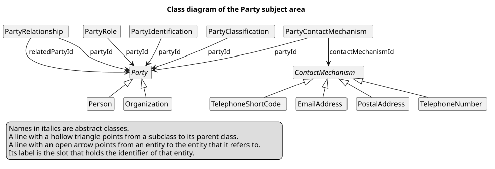

= Party subject area
include::_fpsot-terms.adoc[]

The Party subject area holds the people and organizations that a public body deals with.
It is the first subject area of {abbr-fpsot-first} models.
The file `model/party.yaml` defines it in link:https://linkml.io/linkml/generators/index.html[LinkML].

The class diagram shows its entities and their references.

The diagram shows two abstract classes, each with its subclasses.

* `Party` has the subclasses `Person` and `Organization`.
* `ContactMechanism` has the subclasses `PostalAddress`, `TelephoneNumber`, `TelephoneShortCode` and `EmailAddress`.

It shows seven references, each from an entity to the entity whose `id` it holds.

* `PartyRole` refers to `Party` through `partyId`.
* `PartyRelationship` refers to `Party` twice, through `partyId` and through `relatedPartyId`.
* `PartyContactMechanism` refers to `Party` through `partyId`, and to `ContactMechanism` through `contactMechanismId`.
* `PartyIdentification` refers to `Party` through `partyId`.
* `PartyClassification` refers to `Party` through `partyId`.

Its legend says that names in italics are abstract classes.
A line with a hollow triangle points from a subclass to its parent class.
A line with an open arrow points from an entity to the entity it refers to.
Its label is the slot that holds the identifier.

The source of the diagram, in `diagrams/party-entities-en.puml`, reads as follows.

[source,plantuml]
----
@startuml party-entities-en
' SPDX-License-Identifier: Community-Spec-1.0
' Class diagram of the Party subject area: its entities and the references between them (spec/en/party.adoc, DMO-040 to DMO-047).
title Class diagram of the Party subject area
hide circle
hide methods
hide empty members
skinparam monochrome true
abstract class Party
class Person
class Organization
class PartyRole
class PartyRelationship
abstract class ContactMechanism
class PostalAddress
class TelephoneNumber
class TelephoneShortCode
class EmailAddress
class PartyContactMechanism
class PartyIdentification
class PartyClassification
Party <|-- Person
Party <|-- Organization
ContactMechanism <|-- PostalAddress
ContactMechanism <|-- TelephoneNumber
ContactMechanism <|-- TelephoneShortCode
ContactMechanism <|-- EmailAddress
PartyRole --> Party : partyId
PartyRelationship --> Party : partyId
PartyRelationship --> Party : relatedPartyId
PartyContactMechanism --> Party : partyId
PartyContactMechanism --> ContactMechanism : contactMechanismId
PartyIdentification --> Party : partyId
PartyClassification --> Party : partyId
legend bottom left
  Names in italics are abstract classes.
  A line with a hollow triangle points from a subclass to its parent class.
  A line with an open arrow points from an entity to the entity that it refers to.
  Its label is the slot that holds the identifier of that entity.
endlegend
@enduml
----

A party is a person or an organization.
Roles, relationships, contact links, identifications and classifications each refer to a party through `partyId`.
A relationship also refers to a second party, through `relatedPartyId`.
A contact link also refers to a contact mechanism.
It is a postal address, a telephone number, a telephone short code or an email address.

== Parties

[[DMO-040]]
*DMO-040.* `Party` MUST be an abstract class, and each {term-party} MUST be exactly one `Person` or one `Organization`.
Its `partyType` slot MUST hold `person` or `organization`, and each subclass fixes the value.
One `id` names one party, whatever its subclass.
Other data can then refer to a party without knowing whether it is a person or an organization.

[[DMO-041]]
*DMO-041.* A `Person` MAY hold names, under DMO-032, and a `birthDate`.
This version defines no other slot about a person.
A deployment that needs more MAY add it in an extension, under DMO-053.
A later version can then move it into the core.
Each slot about a person is personal information, so the core holds only what most processes need.

[[DMO-042]]
*DMO-042.* An `Organization` MAY hold names, under DMO-035.
It can be a business, a public body, an association or an informal group.
Apache OFBiz calls this entity `PartyGroup`.
This model uses the term of link:https://schema.org/Organization[schema.org] instead, which readers know better.
The link:https://semiceu.github.io/Core-Business-Vocabulary/releases/2.3.0/[Core Business Vocabulary] also builds its legal entity on an organization class.

== Roles and relationships

[[DMO-043]]
*DMO-043.* Each role of a party MUST be a `PartyRole` entity, with the party, a role code and a period.
A model MUST NOT make a role a subclass of party, such as `Applicant`, or a flag.
One party can then be an applicant, an employer and a supplier at once, each for its own period.
Apache OFBiz gives a party role no period, so the `validity` slot is a departure under DMO-006.
A role in public services often starts and ends on known dates.

[[DMO-044]]
*DMO-044.* A relationship between two parties MUST be a `PartyRelationship` entity.
It holds the first party and its role, the second party and its role, a relationship type and a period.
The relationship reads from the first party to the second, such as from an employer to an employee.
Apache OFBiz reads the same way: its link:https://github.com/apache/ofbiz-framework/blob/e103805ef7f15e9f3802e97b0a5c8a6cb47032b2/applications/datamodel/data/demo/HumanresDemoData.xml[demo data] puts the employer in `partyIdFrom` and the employee in `partyIdTo`.
The roles make clear what each party is in the relationship, even when both are persons.

== Contact mechanisms

[[DMO-045]]
*DMO-045.* Each contact mechanism, such as a postal address or a telephone number, MUST be a `ContactMechanism` entity.
It MUST NOT be a party slot.
A `PartyContactMechanism` entity MUST link it to a party, with purpose codes under DMO-030 and a period.
Several parties MAY share one contact mechanism, such as the people of one household.
A party can then have several addresses, each for a purpose, and keep its past addresses.

== Identifications and classifications

[[DMO-046]]
*DMO-046.* An identifier that a body issues for a party MUST be a `PartyIdentification` entity, not a party slot.
Examples are a business number or a Québec enterprise number.
It holds the scheme as a code, under DMO-030.
It holds the value in the exact form of its issuer, under DAT-066.
It MAY hold the issuing organization and a period.
A party can hold several identifiers, and each one can end or change without a change to the party.

[[DMO-047]]
*DMO-047.* A category of a party in a controlled vocabulary MUST be a `PartyClassification` entity.
It holds the {abbr-uri-first} of the concept scheme, the code of the concept and a period.
The scheme MUST follow the {abbr-fpsot} vocabularies specification, or be the published scheme of another authority.
Examples are an industry classification or a size of business.
The scheme slot lets one entity hold categories from any number of schemes.

== References

=== Normative

* link:https://linkml.io/linkml/generators/index.html[LinkML, Generators], LinkML, 1.12.1. link:https://web.archive.org/web/20261001151732/https://linkml.io/linkml/generators/index.html[Archived copy]

=== Informative

* link:https://github.com/apache/ofbiz-framework/blob/e103805ef7f15e9f3802e97b0a5c8a6cb47032b2/applications/datamodel/data/demo/HumanresDemoData.xml[Apache OFBiz, HumanresDemoData.xml], The Apache Software Foundation, commit e103805, 2026-11-07.
* link:https://semiceu.github.io/Core-Business-Vocabulary/releases/2.3.0/[Core Business Vocabulary], European Commission, SEMIC, 2.3.0, 2026-05-12. link:https://web.archive.org/web/20260618104426/https://semiceu.github.io/Core-Business-Vocabulary/releases/2.3.0/[Archived copy]
* link:https://schema.org/Organization[schema.org, Organization], schema.org, 30.1, 2026-09-16. link:https://web.archive.org/web/20261027165008/https://schema.org/Organization[Archived copy]

== Document history

[cols="1,1,4",options="header"]
|===
|Version |Date |Change
|0.1.0 |2026-11-07 |First version.
|===
