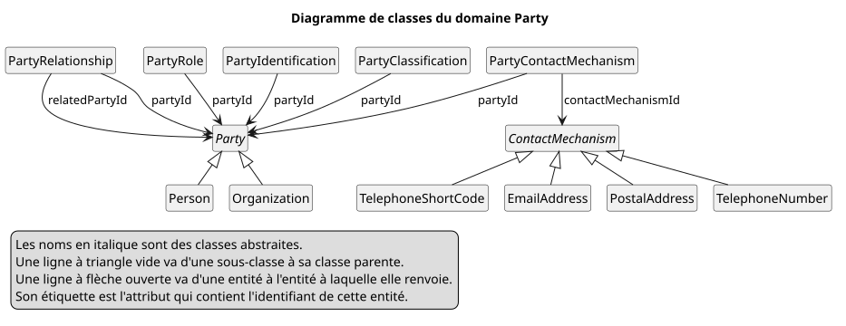

= Domaine Party
include::_fpsot-terms.adoc[]

Le domaine Party regroupe les personnes et les organisations avec lesquelles traite un organisme public.
C’est le premier domaine des modèles de la {abbr-fpsot-first}.
Le fichier `model/party.yaml` le définit en link:https://linkml.io/linkml/generators/index.html[LinkML].

Le diagramme de classes montre ses entités et leurs références.

Le diagramme montre deux classes abstraites, chacune avec ses sous-classes.

* `Party` a les sous-classes `Person` et `Organization`.
* `ContactMechanism` a les sous-classes `PostalAddress`, `TelephoneNumber`, `TelephoneShortCode` et `EmailAddress`.

Il montre sept références, chacune d’une entité vers l’entité dont elle contient l’`id`.

* `PartyRole` renvoie à `Party` par `partyId`.
* `PartyRelationship` renvoie deux fois à `Party`, par `partyId` et par `relatedPartyId`.
* `PartyContactMechanism` renvoie à `Party` par `partyId`, et à `ContactMechanism` par `contactMechanismId`.
* `PartyIdentification` renvoie à `Party` par `partyId`.
* `PartyClassification` renvoie à `Party` par `partyId`.

Sa légende dit que les noms en italique sont des classes abstraites.
Une ligne à triangle vide va d’une sous-classe à sa classe parente.
Une ligne à flèche ouverte va d’une entité à l’entité à laquelle elle renvoie.
Son étiquette est l’attribut qui contient l’identifiant.

La source du diagramme, dans `diagrams/party-entities-fr.puml`, se lit comme suit.

[source,plantuml]
----
@startuml party-entities-fr
' SPDX-License-Identifier: Community-Spec-1.0
' Diagramme de classes du domaine Party : ses entités et les références entre elles (spec/fr/party.adoc, DMO-040 à DMO-047).
title Diagramme de classes du domaine Party
hide circle
hide methods
hide empty members
skinparam monochrome true
abstract class Party
class Person
class Organization
class PartyRole
class PartyRelationship
abstract class ContactMechanism
class PostalAddress
class TelephoneNumber
class TelephoneShortCode
class EmailAddress
class PartyContactMechanism
class PartyIdentification
class PartyClassification
Party <|-- Person
Party <|-- Organization
ContactMechanism <|-- PostalAddress
ContactMechanism <|-- TelephoneNumber
ContactMechanism <|-- TelephoneShortCode
ContactMechanism <|-- EmailAddress
PartyRole --> Party : partyId
PartyRelationship --> Party : partyId
PartyRelationship --> Party : relatedPartyId
PartyContactMechanism --> Party : partyId
PartyContactMechanism --> ContactMechanism : contactMechanismId
PartyIdentification --> Party : partyId
PartyClassification --> Party : partyId
legend bottom left
  Les noms en italique sont des classes abstraites.
  Une ligne à triangle vide va d'une sous-classe à sa classe parente.
  Une ligne à flèche ouverte va d'une entité à l'entité à laquelle elle renvoie.
  Son étiquette est l'attribut qui contient l'identifiant de cette entité.
endlegend
@enduml
----

Une partie est une personne ou une organisation.
Les rôles, les relations, les liens de contact, les identifications et les classifications renvoient chacun à une partie par `partyId`.
Une relation renvoie aussi à une deuxième partie, par `relatedPartyId`.
Un lien de contact renvoie aussi à un moyen de contact.
C’est une adresse postale, un numéro de téléphone, un numéro abrégé ou une adresse de courriel.

== Parties

[[DMO-040]]
*DMO-040.* `Party` DOIT être une classe abstraite, et chaque {term-party} DOIT être exactement une `Person` ou une `Organization`.
Son attribut `partyType` DOIT contenir `person` ou `organization`, et chaque sous-classe fixe la valeur.
Un `id` nomme une seule partie, quelle que soit sa sous-classe.
D’autres données peuvent alors renvoyer à une partie sans savoir s’il s’agit d’une personne ou d’une organisation.

[[DMO-041]]
*DMO-041.* Une `Person` PEUT contenir des noms, selon DMO-032, et une date de naissance, `birthDate`.
Cette version ne définit aucun autre attribut sur une personne.
Un déploiement qui en a besoin PEUT en ajouter dans une extension, selon DMO-053.
Une version ultérieure peut ensuite les déplacer dans le modèle de base.
Chaque attribut sur une personne est un renseignement personnel.
Le modèle de base contient donc seulement ce dont la plupart des processus ont besoin.

[[DMO-042]]
*DMO-042.* Une `Organization` PEUT contenir des noms, selon DMO-035.
Elle peut être une entreprise, un organisme public, une association ou un groupe informel.
Apache OFBiz nomme cette entité `PartyGroup`.
Ce modèle emploie plutôt le terme de link:https://schema.org/Organization[schema.org], mieux connu du lectorat.
Le link:https://semiceu.github.io/Core-Business-Vocabulary/releases/2.3.0/[Core Business Vocabulary] bâtit aussi son entité juridique sur une classe d’organisation.

== Rôles et relations

[[DMO-043]]
*DMO-043.* Chaque rôle d’une partie DOIT être une entité `PartyRole`, avec la partie, un code de rôle et une période.
Un modèle NE DOIT PAS faire d’un rôle une sous-classe de partie, comme `Applicant`, ni un indicateur.
Une même partie peut alors être à la fois demanderesse, employeuse et fournisseuse, chaque rôle ayant sa propre période.
Apache OFBiz ne donne pas de période à un rôle de partie.
L’attribut `validity` est donc un écart selon DMO-006.
Dans les services publics, un rôle commence et finit souvent à des dates connues.

[[DMO-044]]
*DMO-044.* Une relation entre deux parties DOIT être une entité `PartyRelationship`.
Elle contient chaque partie avec son rôle, un type de relation et une période.
La relation se lit de la première partie vers la deuxième, comme d’un employeur vers une personne employée.
Apache OFBiz se lit dans le même sens.
Ses link:https://github.com/apache/ofbiz-framework/blob/e103805ef7f15e9f3802e97b0a5c8a6cb47032b2/applications/datamodel/data/demo/HumanresDemoData.xml[données de démonstration] placent l’employeur dans `partyIdFrom` et la personne employée dans `partyIdTo`.
Les rôles disent clairement ce qu’est chaque partie dans la relation, même quand les deux sont des personnes.

== Moyens de contact

[[DMO-045]]
*DMO-045.* Chaque moyen de contact, comme une adresse postale ou un numéro de téléphone, DOIT être une entité `ContactMechanism`.
Ce NE DOIT PAS être un attribut de partie.
Une entité `PartyContactMechanism` DOIT la relier à une partie, avec des codes de but selon DMO-030 et une période.
Plusieurs parties PEUVENT partager un même moyen de contact, comme les membres d’un ménage.
Une partie peut alors avoir plusieurs adresses, chacune pour un but, et garder ses anciennes adresses.

== Identifications et classifications

[[DMO-046]]
*DMO-046.* Un identifiant qu’un organisme attribue à une partie DOIT être une entité `PartyIdentification`, et non un attribut de partie.
C’est le cas d’un numéro d’entreprise ou d’un numéro d’entreprise du Québec.
Elle contient le schéma d’identification sous forme de code, selon DMO-030.
Elle contient la valeur dans la forme exacte de son émetteur, selon DAT-066.
Elle PEUT contenir l’organisation émettrice et une période.
Une partie peut avoir plusieurs identifiants, et chacun peut prendre fin ou changer sans changement de la partie.

[[DMO-047]]
*DMO-047.* La catégorie d’une partie dans un vocabulaire contrôlé DOIT être une entité `PartyClassification`.
Elle contient l’{abbr-uri-first} du schéma de concepts, le code du concept et une période.
Le schéma DOIT suivre la spécification de {abbr-fpsot} sur les vocabulaires, ou être le schéma publié d’une autre autorité.
C’est le cas d’une classification des industries ou d’une taille d’entreprise.
L’attribut du schéma permet à une seule entité de contenir des catégories de n’importe quel nombre de schémas.

== Références

=== Références normatives

* link:https://linkml.io/linkml/generators/index.html[LinkML, Generators], LinkML, 1.12.1. link:https://web.archive.org/web/20261001151732/https://linkml.io/linkml/generators/index.html[Copie archivée]

=== Références informatives

* link:https://github.com/apache/ofbiz-framework/blob/e103805ef7f15e9f3802e97b0a5c8a6cb47032b2/applications/datamodel/data/demo/HumanresDemoData.xml[Apache OFBiz, HumanresDemoData.xml], The Apache Software Foundation, archivage e103805, 2026-11-07.
* link:https://semiceu.github.io/Core-Business-Vocabulary/releases/2.3.0/[Core Business Vocabulary], European Commission, SEMIC, 2.3.0, 2026-05-12. link:https://web.archive.org/web/20260618104426/https://semiceu.github.io/Core-Business-Vocabulary/releases/2.3.0/[Copie archivée]
* link:https://schema.org/Organization[schema.org, Organization], schema.org, 30.1, 2026-09-16. link:https://web.archive.org/web/20261027165008/https://schema.org/Organization[Copie archivée]

== Historique du document

[cols="1,1,4",options="header"]
|===
|Version |Date |Changement
|0.1.0 |2026-11-07 |Première version.
|===
